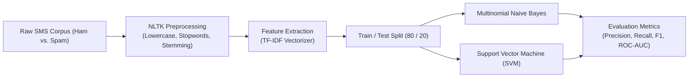

<p align="center">
  
</p>

<p align="center">
  
  
  
  
</p>

<a id="overview"></a>
## 📖 Executive Summary & Overview

Short Message Service (SMS) spam poses ongoing cybersecurity risks, exposing mobile subscribers to phishing schemes, fraudulent financial scams, and malware links. Unlike long-form emails, SMS messages present distinct NLP classification challenges: short text length, high incidence of informal slang, obfuscated tokens (e.g. `w1nner`, `f-r-e-e`), and severe class imbalance.

The **SMS Spam Detection** project provides an end-to-end Natural Language Processing machine learning solution developed for the NLP course (E1CAA312) at Alliance University. Documented across `NLP+PROJECT+CODES.pdf` and `NLP_Project_Report (1).docx`, the pipeline executes text cleaning, tokenization, stopword filtering, lemmatization, TF-IDF vectorization, and model training using **Multinomial Naive Bayes and Support Vector Machines (SVM)** to achieve superior spam detection accuracy.

<a id="toc"></a>
## 📑 Table of Contents

- [📖 Executive Summary & Overview](#overview)
- [🎯 Key Features & Capabilities](#features)
- [🏗️ System Architecture & Pipeline](#architecture)
- [🛠️ Tech Stack Breakdown](#tech-stack)
- [⚙️ Reproducible Quickstart & Setup](#setup)
- [📁 Project Directory Layout](#project-layout)
- [👨‍💻 Author & Contributions](#author)

<a id="features"></a>
## 🎯 Key Features & Capabilities

- **NLP Preprocessing Pipeline:** Tokenization, punctuation removal, lowercasing, English stopword elimination, and Porter/Snowball stemming or WordNet lemmatization via NLTK.
- **TF-IDF Feature Extraction:** Converting raw SMS strings into sparse term frequency-inverse document frequency vector representations.
- **Supervised Classifier Benchmarking:** Comparative evaluation of Multinomial Naive Bayes ($P(\text{Spam}|\mathbf{w})$) and Support Vector Machines (SVM).
- **Classification Performance Metrics:** Confusion matrices, Precision, Recall, and F1-Scores tailored for low false-positive constraints (avoiding flagging legitimate ham as spam).

<a id="architecture"></a>
## 🏗️ System Architecture & Pipeline



<a id="tech-stack"></a>
## 🛠️ Tech Stack Breakdown

| Stage | Library / Tool | Implementation Details |
| :--- | :--- | :--- |
| **Language Runtime** | Python 3.8+ | Primary programming language |
| **NLP Preprocessing** | NLTK (Natural Language Toolkit) | Tokenizers, corpus stopwords, lemmatizers |
| **Feature Extraction** | `sklearn.feature_extraction.text` | `TfidfVectorizer` (sublinear TF scaling) |
| **Machine Learning** | Scikit-learn | `MultinomialNB`, `LinearSVC`, classification reports |
| **Data Munging** | Pandas & NumPy | Series operations, label encoding (Ham=0, Spam=1) |

<a id="setup"></a>
## ⚙️ Reproducible Quickstart & Setup

### Prerequisites
- Python 3.8+ with virtual environment

```bash
# 1. Clone repository
git clone https://github.com/Amaraiah11/SMS-Spam-Detection.git
cd SMS-Spam-Detection

# 2. Setup virtual environment
python -m venv venv
venv\Scripts\activate   # Windows

# 3. Install packages
pip install nltk scikit-learn pandas numpy matplotlib

# 4. Review documented Python code
# Inspect 'NLP+PROJECT+CODES.pdf' for reproducible notebook cells
```

<a id="project-layout"></a>
## 📁 Project Directory Layout

```text
SMS-Spam-Detection/
├── NLP+PROJECT+CODES.pdf      # Complete Python code and cell execution logs
├── NLP_Project_Report (1).docx# Formal NLP academic project report
└── README.md                  # Comprehensive machine learning documentation
```

<a id="author"></a>
## 👨‍💻 Author & Contributions

This project is developed and maintained with high technical rigour by **Amaraiah C**, Software Engineer and Data Analytics Practitioner studying Bachelor of Computer Applications (BCA) at Alliance University.

- 🌐 **GitHub:** [@Amaraiah11](https://github.com/Amaraiah11)
- 💼 **LinkedIn:** [Connect on LinkedIn](https://www.linkedin.com/in/amaraiah-c/)
- 📧 **Institutional Contact:** `camaraiahBCA24@ced.alliance.edu.in`

### 🤝 Contribution Guidelines
Contributions, bug reports, and architectural discussions are welcome!
1. **Fork** the repository: `https://github.com/Amaraiah11/SMS-Spam-Detection`
2. **Branch**: `git checkout -b feature/your-feature-name`
3. **Commit**: `git commit -m "feat: enhance feature logic"`
4. **Push**: `git push origin feature/your-feature-name`
5. **Open Pull Request** against the `Amaraiah-C` branch.

---

<p align="center">
  <b>⭐ If this codebase or documentation assisted your engineering workflows, please star the repository! ⭐</b>
</p>

<p align="center">
  
</p>
