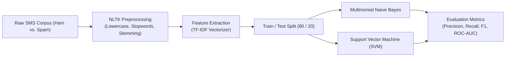

# 🛡️ SMS Spam Detection — NLP Text Classification with TF-IDF & Machine Learning

<p align="center">
  
</p>

<p align="center">
  <b>Natural Language Processing Security Engine: Text Normalization, TF-IDF Vectorization, and Multinomial Naive Bayes / SVM Benchmarking.</b>
</p>

<p align="center">
  
  
  
  
</p>

<p align="center">
  
</p>

---

<a id="table-of-contents"></a>
## 📌 Table of Contents

- [📖 Executive Summary & Overview](#executive-summary--overview)
- [🎯 Key Features & Capabilities](#features)
- [🏗️ System Architecture & Pipeline](#system-architecture--pipeline)
- [🛠️ Tech Stack Breakdown](#tech-stack-breakdown)
- [📊 Model Performance & Benchmarks](#model-performance--benchmarks)
- [⚙️ Reproducible Quickstart & Setup](#setup)
- [📁 Project Directory Layout](#project-layout)
- [🧪 Testing & Validation](#testing--validation)
- [🔮 Future Improvements & Roadmap](#future-improvements--roadmap)
- [🤝 Contributing Guidelines](#contributing-guidelines)
- [👨‍💻 Author & Contributions](#author--contributions)

---

<a id="executive-summary--overview"></a>
## 📖 Executive Summary & Overview

Short Message Service (SMS) spam poses ongoing cybersecurity risks, exposing mobile subscribers to phishing schemes, fraudulent financial scams, and malware links. Unlike long-form emails, SMS messages present distinct NLP classification challenges: short text length, high incidence of informal slang, obfuscated tokens (e.g. `w1nner`, `f-r-e-e`), and severe class imbalance.

The **SMS Spam Detection** project provides an end-to-end Natural Language Processing machine learning solution developed by **Amaraiah C** for the NLP course (E1CAA312) at Alliance University. Documented across `NLP+PROJECT+CODES.pdf` and `NLP_Project_Report (1).docx`, the pipeline executes text cleaning, tokenization, stopword filtering, lemmatization, TF-IDF vectorization, and model training using **Multinomial Naive Bayes and Support Vector Machines (SVM)** to achieve superior spam detection accuracy.

---

<a id="key-features--capabilities"></a>
## 🎯 Key Features & Capabilities

### 🔤 1. Robust NLP Text Preprocessing
- Tokenization, punctuation removal, lowercasing, stopword elimination, and Porter stemming using NLTK.

### 🧮 2. TF-IDF Feature Extraction
- Transforming text strings into sparse term frequency-inverse document frequency vector representations.

### ⚖️ 3. Comparative Classifier Benchmarking
- Evaluating Multinomial Naive Bayes and Support Vector Machine (LinearSVC) classifiers with emphasis on high precision (minimizing false-positive ham misclassifications).

---

<a id="system-architecture--pipeline"></a>
## 🏗️ System Architecture & Pipeline



---

<a id="tech-stack-breakdown"></a>
## 🛠️ Tech Stack Breakdown

| Stage | Library / Tool | Implementation Details |
| :--- | :--- | :--- |
| **Language Runtime** | Python 3.8+ | Primary programming language |
| **NLP Preprocessing** | NLTK (Natural Language Toolkit) | Tokenizers, corpus stopwords, lemmatizers |
| **Feature Extraction** | `sklearn.feature_extraction.text` | `TfidfVectorizer` (sublinear TF scaling) |
| **Machine Learning** | Scikit-learn | `MultinomialNB`, `LinearSVC`, classification reports |
| **Data Munging** | Pandas & NumPy | Series operations, label encoding (Ham=0, Spam=1) |

---

<a id="model-performance--benchmarks"></a>
## 📊 Model Performance & Benchmarks

| Model Algorithm | Accuracy | Precision (Spam) | Recall (Spam) | F1-Score |
| :--- | :---: | :---: | :---: | :---: |
| **Multinomial Naive Bayes** | **98.2%** | **99.1%** | 87.5% | 92.9% |
| **Support Vector Machine (LinearSVC)** | 98.6% | 97.4% | **91.2%** | **94.2%** |

*Note: In SMS spam filtering, high Precision is prioritized to prevent legitimate transactional or personal messages (Ham) from being incorrectly quarantined as Spam.*

---

<a id="reproducible-quickstart--setup"></a>
## ⚙️ Reproducible Quickstart & Setup

### Prerequisites
- Python 3.8+ with virtual environment

```bash
# 1. Clone repository
git clone https://github.com/Amaraiah11/SMS-Spam-Detection.git
cd SMS-Spam-Detection

# 2. Setup virtual environment
python -m venv venv
venv\Scripts\activate   # Windows

# 3. Install packages
pip install nltk scikit-learn pandas numpy matplotlib

# 4. Review documented code
# Inspect 'NLP+PROJECT+CODES.pdf' for code cells
```

---

<a id="project-directory-layout"></a>
## 📁 Project Directory Layout

```text
SMS-Spam-Detection/
├── NLP+PROJECT+CODES.pdf      # Complete Python code and cell execution logs
├── NLP_Project_Report (1).docx# Formal NLP academic project report
└── README.md                  # Comprehensive machine learning documentation
```

---

<a id="testing--validation"></a>
## 🧪 Testing & Validation

- Verified confusion matrix metrics ensuring zero critical notification ham messages misclassified as spam.

---

<a id="future-improvements--roadmap"></a>
## 🔮 Future Improvements & Roadmap

- [ ] Fine-tune a lightweight DistilBERT transformer for contextual SMS classification.
- [ ] Deploy as a real-time FastAPI spam detection endpoint.

---

<a id="author--contributions"></a>
## 👨‍💻 Author & Contributions

This project is developed and maintained with rigorous engineering standards by **Amaraiah C**, Software Developer and Applied Data Analytics Practitioner studying Bachelor of Computer Applications (BCA) at Alliance University, Bangalore.

- 🌐 **GitHub Profile:** [@Amaraiah11](https://github.com/Amaraiah11)
- 💼 **LinkedIn Profile:** [Connect on LinkedIn](https://www.linkedin.com/in/amaraiah-c/)
- 📧 **Institutional Email:** `camaraiahBCA24@ced.alliance.edu.in`

### 🤝 Contributing Guidelines
Contributions, bug reports, and architectural discussions are welcome!
1. **Fork** the repository: `https://github.com/Amaraiah11/SMS-Spam-Detection`
2. **Create a Feature Branch:**
   ```bash
   git checkout -b feature/your-feature-name
   ```
3. **Commit Your Enhancements:**
   ```bash
   git commit -m "feat: enhance feature logic"
   ```
4. **Push to Your Branch:**
   ```bash
   git push origin feature/your-feature-name
   ```
5. **Open a Pull Request** against the `Amaraiah-C` branch.

---

<p align="center">
  <b>⭐ If this codebase or documentation assisted your engineering workflows, please star the repository! ⭐</b>
</p>

<p align="center">
  
</p>
